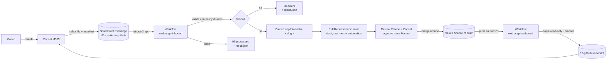

# Cosmic Territory — AI Exchange Bridge: proposta architetturale

> **Stato:** proposta revisionabile. Non autorizza la creazione di workflow, funzioni, flow, app, credenziali o siti SharePoint. Ogni passo con effetti richiede la decisione esplicita di Matteo (sezione 28).

## 1. Executive Summary

**Problema.** Copilot (Microsoft 365) lavora su SharePoint/OneDrive/Teams e non può autenticarsi al repository GitHub privato. Oggi Matteo fa da "postino" tra Copilot e Claude.

**Principio non negoziabile.** GitHub privato = unica Source of Truth. SharePoint è solo una *casella postale*: contiene input, copie temporanee, manifest, log. Nessun contenuto di SharePoint ha valore normativo.

**Raccomandazione.** Realizzare il bridge in **due tempi**:

1. **Fase 0 (subito, nessuna infrastruttura nuova):** Claude fa da bridge *manuale assistito* tramite il connettore Microsoft 365 già disponibile nelle sessioni Claude, sempre con PR e review umana. Serve a validare cartelle, manifest e regole prima di automatizzare.
2. **Target (alternativa 4): GitHub Actions + Microsoft Graph**, con:
   - identità Microsoft **senza segreti** (Entra Workload Identity Federation: GitHub Actions presenta il proprio token OIDC, nessuna password o chiave Microsoft da custodire);
   - identità GitHub tramite **GitHub App** installata solo su questo repository, senza permesso di merge né di modificare i workflow;
   - **policy e codice di validazione dentro il repository** (versionati, protetti da CODEOWNERS), mai nei documenti scambiati;
   - **manifest separato** (YAML con schema chiuso) per ogni file;
   - PR sempre aperta verso `main`, **mai merge automatico**.

**Perché non Power Automate.** Il connettore GitHub nativo di Power Automate copre soprattutto issue e release, non commit/PR su file: servirebbe l'azione HTTP (connettore *premium*) e la gestione di firma JWT della GitHub App dentro un flow, scomoda e poco auditabile. Power Automate resta utile solo come eventuale "campanello" opzionale (sezione 6, alternativa 3).

**Costi.** Nessun servizio aggiuntivo obbligatorio nel target: SharePoint e Entra sono inclusi in Microsoft 365; GitHub Actions consuma minuti del piano GitHub (da verificare: piano, rulesets su repository privati, quota minuti — sezione 22).

## 2. Requisiti e assunzioni

### Requisiti funzionali
- RF1. Copilot → GitHub: file + manifest in SharePoint → branch → commit → PR verso `main`.
- RF2. GitHub → Copilot: copie temporanee di artefatti selezionati in SharePoint.
- RF3. Esito di ogni elaborazione registrato nell'area Exchange; artefatto spostato in `99-processed` o `90-errors`.
- RF4. Directory GitHub scrivibili inizialmente: solo `docs/`.

### Requisiti non funzionali
- RNF1. Nessun segreto in file, codice, log, manifest o documenti.
- RNF2. Privilegi minimi: un solo repository, un solo sito SharePoint, nessun merge, nessuna modifica a `.github/`.
- RNF3. Il contenuto di un documento non può mai cambiare le regole del bridge.
- RNF4. Idempotenza: rielaborare lo stesso input non produce duplicati.
- RNF5. Audit completo e leggibile da una persona non programmatrice.
- RNF6. Manutenibile: il flusso deve restare comprensibile e correggibile da un analista, con Claude come supporto.

### Assunzioni (da verificare — vedi sezione 28)
- A1. Il repository è `servisys/cosmic-horror` (account `servisys`); "Cosmic Territory" è il nome del progetto, non del repository. I manifest usano il nome reale del repository.
- A2. Copilot (o Matteo, per suo conto) è in grado di **salvare un file `.md` e il suo manifest in una cartella SharePoint**. Copilot Chat da solo non scrive file; Copilot in Word/Pages o il salvataggio manuale sì. Da provare in Fase 0.
- A3. Volume previsto: pochi file al giorno, tutti di testo Markdown di dimensione ridotta.
- A4. Il tenant Microsoft 365 ha un amministratore (Matteo o delegato) in grado di registrare un'app in Entra e concedere consenso.
- A5. Il piano GitHub supporta le protezioni di branch o i *rulesets* sui repository privati (da verificare: spesso richiede un piano a pagamento).

## 3. Architettura raccomandata

**Fase 0:** Claude (sessione con connettore Microsoft 365) ↔ SharePoint; Claude ↔ GitHub (branch + PR).
**Target:** GitHub Actions (due workflow) + Microsoft Graph, con GitHub App e Workload Identity Federation.

Tutta la logica sta in uno script nel repository (`tools/ai-exchange/`, da creare in implementazione, **non ora**), eseguito dai workflow. Il codice e la policy vengono letti **sempre dal branch `main`**: un file depositato in SharePoint non può modificarli.

## 4. Diagramma del flusso



## 5. Componenti

| # | Componente | Ruolo | Dove vive |
|---|---|---|---|
| 1 | Sito SharePoint dedicato "Cosmic Territory AI Exchange" | Casella postale | Microsoft 365 |
| 2 | Entra app registration (solo Graph, `Sites.Selected`) + credenziale federata GitHub OIDC | Identità Microsoft del bridge, senza segreti | Entra |
| 3 | GitHub App "CT AI Exchange" (solo questo repo) | Identità GitHub del bridge | GitHub |
| 4 | Workflow `exchange-inbound` | Copilot → GitHub | `.github/workflows/` (protetto) |
| 5 | Workflow `exchange-outbound` | GitHub → Copilot | `.github/workflows/` (protetto) |
| 6 | Script di bridge + schema manifest | Validazione e operazioni | `tools/ai-exchange/` (protetto) |
| 7 | `policy.yaml` | Allowlist: repo, directory, utenti, limiti | `tools/ai-exchange/` (protetto da CODEOWNERS) |
| 8 | Ruleset su `main` | Nessun push diretto, review umana obbligatoria | GitHub |

## 6. Confronto delle alternative

Legenda: 🟢 favorevole · 🟡 accettabile · 🔴 sfavorevole.

| Criterio | 1. Power Automate + GitHub REST | 2. Azure Function + GitHub REST | 3. Power Automate + Azure Function | 4. **GitHub Actions + Graph** | 5. Claude come bridge (Fase 0) |
|---|---|---|---|---|---|
| Complessità iniziale | 🟡 trigger SharePoint facile, parte GitHub scomoda | 🔴 codice + hosting + deploy | 🔴 due sistemi | 🟡 un workflow + registrazioni app | 🟢 nessuna |
| Manutenzione | 🟡 flow grafici, poco versionabili | 🟡 codice da mantenere e aggiornare | 🔴 due superfici | 🟢 codice in Git, PR e review | 🟢 nessuna infrastruttura |
| Auth GitHub | 🔴 PAT o JWT di App dentro un flow | 🟢 GitHub App, chiave in Key Vault | 🟢 come 2 | 🟢 GitHub App, token di installazione a vita breve | 🟢 sessione Claude già autorizzata |
| Auth Microsoft | 🟢 connettore nativo | 🟡 app Entra + managed identity | 🟢 | 🟢 federata OIDC, nessun segreto | 🟢 connettore già in uso |
| Repo privati | 🟢 | 🟢 | 🟢 | 🟢 | 🟢 |
| Segreti | 🔴 nelle connessioni del flow | 🟢 Key Vault + managed identity | 🟡 | 🟢 solo chiave App (secret di environment) | 🟢 nessuno nuovo |
| Branch/commit/PR | 🔴 richiede HTTP premium | 🟢 | 🟢 | 🟢 | 🟢 |
| Conflitti, retry, idempotenza | 🔴 difficile da esprimere | 🟢 | 🟢 | 🟢 `concurrency` + ledger | 🟡 manuale |
| Logging e audit | 🟡 cronologia run, non in Git | 🟢 Application Insights | 🟡 | 🟢 log run + result.json + PR | 🟡 trascrizioni sessione |
| Limiti API | 🟡 limiti flow e connettori | 🟢 | 🟡 | 🟡 cron minimo 5 min, best effort | 🟢 |
| Costi | 🟡 HTTP premium (licenza) | 🟡 sottoscrizione Azure (consumo basso) | 🔴 somma | 🟢 minuti Actions (verificare quota) | 🟢 già in uso |
| Dipendenze | Power Platform | Azure + codice | Power Platform + Azure | GitHub + Entra | Sessione Claude attiva |
| Failure mode principale | token in scadenza, flow disattivato | funzione non aggiornata, cold start | desincronizzazione tra i due | cron in ritardo/disattivato | nessuno lancia il lavoro |
| Vendor lock-in | 🔴 Microsoft | 🟡 Azure | 🔴 | 🟢 logica portabile (script) | 🟢 |

**Sul trigger.** L'alternativa 4 interroga SharePoint a intervalli (cron) o su richiesta (`workflow_dispatch`). Se serve reattività immediata si può aggiungere come *campanello* un flow Power Automate che chiama `workflow_dispatch` (richiede HTTP premium) — opzionale, evoluzione futura.

## 7. Motivazione della scelta

1. **Tutta la logica in Git**: validazione, policy e schema sono rivedibili in PR come ogni altro file, coerentemente con "GitHub è la verità".
2. **Zero segreti Microsoft**: la federazione OIDC elimina la chiave più pericolosa. Resta una sola chiave (GitHub App), con permessi minimi.
3. **Nessuna infrastruttura da amministrare** (niente VM, niente funzioni, niente Key Vault obbligatorio).
4. **Le regole stanno su `main`**: i workflow `schedule`/`workflow_dispatch` usano sempre la versione del branch predefinito.
5. **Rischio contenuto e riproducibilità**: lo script è deterministico, **nessun LLM nel percorso di automazione**.
6. **Evolvibile**: se un giorno servirà reattività o più sistemi, la stessa logica può essere spostata in una funzione senza cambiare formati e policy.

L'alternativa 5 (Claude come bridge) non è il target perché dipende da una sessione avviata a mano, ma è il modo più sicuro per **imparare prima di automatizzare**.

## 8. Autenticazione GitHub

- **GitHub App** dedicata, installata *solo* su `servisys/cosmic-horror`.
- Permessi: `Contents: write`, `Pull requests: write`, `Metadata: read`. **Non** concessi: `Workflows`, `Administration`, `Actions`, `Secrets`, e nessun permesso sull'organizzazione.
- Token di installazione generato a ogni esecuzione, validità breve (circa un'ora), mai persistito.
- Il merge su `main` è impedito dal ruleset (sezione 16), non dalla sola assenza di codice: l'App **non** è tra i *bypass actors*.
- Alternative scartate: PAT personale (legato a una persona, ampio, scadenza manuale); `GITHUB_TOKEN` da solo (le PR create con questo token non avviano altri workflow e richiede l'impostazione che consente ad Actions di creare PR: accettabile in MVP, ma l'App dà identità riconoscibile e permessi mirati).
- Proprietà dell'App: account `servisys` (o organizzazione, se esiste). **Da decidere (sezione 28).**

## 9. Autenticazione Microsoft 365 / Graph

- **Entra app registration** dedicata, permesso *applicativo* Graph **`Sites.Selected`** (non `Sites.ReadWrite.All`), concesso a **un solo sito** (il sito Exchange) con ruolo di scrittura da un amministratore.
- **Workload Identity Federation**: credenziale federata che si fida del token OIDC di GitHub Actions per il solo soggetto `repo:servisys/cosmic-horror` limitato al branch `main` / all'environment `ai-exchange`. Nessun client secret né certificato.
- `Sites.Selected` non limita a una cartella: per questo serve un **sito dedicato** e non una cartella dentro un sito condiviso.
- Identità dell'autore: il bridge legge da Graph chi ha caricato i file (`createdBy`/`lastModifiedBy`); **solo gli UPN presenti in `policy.yaml`** sono accettati. Il campo `requested_by` del manifest è solo informativo.
- Verificare in implementazione i dettagli correnti della federazione per Graph (i nomi dei passaggi nel portale cambiano).

## 10. Gestione dei secret

| Elemento | Tipo | Dove | Note |
|---|---|---|---|
| Chiave privata GitHub App | **Secret** | Secret di *environment* `ai-exchange` (limitato al branch `main`) | Unico segreto del sistema |
| App ID, Installation ID | Non segreto | Variabili del repository | |
| Credenziale Graph | Nessun segreto | Federazione OIDC | |
| Tenant ID, Client ID | Non segreto | Variabili del repository | |

- Nessun segreto in codice, manifest, documenti, log, PR, commenti. I log del bridge non stampano header né token (mascheramento automatico di Actions + filtri esplicativi).
- **Evoluzione opzionale:** custodire la chiave App in **Azure Key Vault** e leggerla via OIDC (costo trascurabile ma una dipendenza in più). Non necessario per l'MVP.
- Rotazione: la chiave App si ruota con data fissata (proposta: ogni 12 mesi) e quando cambia chi amministra.
- Scansione segreti: abilitare il secret scanning del repository (se il piano lo prevede) e aggiungere al bridge un controllo preventivo su pattern di credenziali nel payload (sezione 13).

## 11. Struttura SharePoint Exchange

Sito dedicato: **Cosmic Territory AI Exchange** (non è un archivio documentale alternativo).

```
Cosmic Territory AI Exchange/
├── 01-copilot-to-github/    # input: <task>.md + <task>.manifest.yaml
├── 02-github-to-copilot/    # copie temporanee read-only (banner + commit di origine)
├── 03-reviews/              # review e consolidamenti (esportati e/o prodotti)
├── 04-tasks/                # task assegnati (modello del Master Index)
├── 90-errors/               # input rifiutati + <task>.result.json
└── 99-processed/            # input elaborati + <task>.result.json (per data)
```

Regole:
- Permessi: scrittura su `01-` solo a Matteo e ai membri indicati in `policy.yaml`; `02-` scrivibile solo dall'identità del bridge (Copilot può leggere); `90-`/`99-` sola lettura per le persone.
- Retention di `99-processed`: proposta 90 giorni, poi eliminazione (la storia vera è in Git).
- Ogni file di `02-` inizia con il banner: *«COPIA DI SOLA LETTURA — fonte: GitHub, commit `<sha>`, generata il `<data>`. Non modificare qui: le proposte vanno in `01-copilot-to-github`.»*
- Nessun contenuto di `reference/` viene esportato né accettato (materiale con diritti non verificati).

## 12. Formato manifest raccomandato

### Confronto

| Criterio | A. Front matter nel `.md` | B. Manifest separato | C. Metadati SharePoint | D. Ibrido |
|---|---|---|---|---|
| Semplicità per Copilot | 🟢 un solo file | 🟡 due file da produrre | 🔴 colonne da compilare in UI | 🟡 |
| Validazione | 🟡 contesto misto | 🟢 schema chiuso | 🔴 tipi deboli | 🟢 |
| Rischio che il manifest sia contenuto o viceversa | 🔴 alto: il documento *contiene* le regole | 🟢 basso: separazione netta | 🟢 | 🟢 |
| File non Markdown | 🔴 non applicabile | 🟢 | 🟢 | 🟢 |
| Idempotenza e integrità | 🔴 l'hash include il front matter | 🟢 `sha256` del payload nel manifest | 🔴 | 🟢 |
| Versionamento | 🟡 | 🟢 schema versionato | 🔴 | 🟢 |
| Concorrenza | 🔴 | 🟢 `base_blob_sha` | 🔴 | 🟢 |

**Raccomandazione: B (manifest separato, YAML con schema chiuso).** Il front matter dei documenti del progetto (`title`, `status`, `version`…) resta **metadato del documento** (come da Master Index) e **non viene mai interpretato dal bridge**. Un `.manifest.yaml` per ciascun payload, con lo stesso nome base.

### Schema (v1)

```yaml
schema_version: 1
project: cosmic-territory
task_id: CT-DES-001                  # ^CT-[A-Z]{3,5}-[0-9]{3,4}$
correlation_id: <UUID-v4>            # generato da chi crea il manifest
payload:
  file: CT_VISION_AND_PILLARS_v0.2.md
  sha256: <sha256 esadecimale del payload, 64 caratteri>
  media_type: text/markdown
target:
  repo: servisys/cosmic-horror       # deve coincidere con policy.yaml
  path: docs/00-project-overview/01-vision-concept/CT_VISION_AND_PILLARS.md
  operation: update                  # create | update
  base_blob_sha: <blob sha Git attuale del file, null se create>
source_status: DRAFT                 # IDEA | DRAFT | REVIEW (APPROVED non ammesso)
requested_by: Matteo                 # informativo, non autorizza nulla
created_at: 2026-10-28T20:00:00Z
pr:
  title: "Vision v0.2 — consolidamento review v0.1"   # max 100 caratteri, testo semplice
  summary: "Testo breve, testo semplice"             # max 1000 caratteri
```

Scelte deliberate:
- **`create` / `update` espliciti** invece di `create-or-update`: quest'ultimo nasconde i conflitti. `update` richiede `base_blob_sha` (concorrenza ottimistica).
- **Assenti dal manifest** (stabiliti dalla policy, quindi non influenzabili da chi scrive): `branch_prefix`, `base_branch`, `create_pull_request`, etichette, reviewer. La PR è **sempre** creata, sempre verso `main`, sempre in *draft*.
- `source_status: APPROVED` rifiutato: l'approvazione avviene solo con il merge umano.
- Schema **chiuso** (`additionalProperties: false`): qualsiasi campo sconosciuto → rifiuto.
- **Associazione file-manifest**: stesso nome base + hash nel manifest. Il bridge elabora solo quando esistono entrambi; per evitare letture di caricamenti parziali si carica **prima il payload e per ultimo il manifest** (il manifest è il segnale "pronto"), e si ignorano file modificati negli ultimi 2 minuti.
- Più file per task: fuori MVP (un task = un file); in futuro array `payloads[]` e commit unico via Git Data API.
- File non Markdown: fuori MVP; in futuro lista `allowed_media_types` nella policy (immagini solo dopo decisione esplicita).

## 13. Regole di validazione

Tutte eseguite *prima* di qualunque scrittura; fallimento = rifiuto in `90-errors` con motivo.

**Identità e struttura**
1. Autore del file (da Graph) ∈ allowlist UPN di `policy.yaml`.
2. Esistono payload e manifest con lo stesso nome base; nome file `[A-Za-z0-9._-]+`, nessun carattere di controllo.
3. Manifest: YAML parsato in modalità sicura (niente tag/oggetti arbitrari, niente anchor/alias), conforme allo schema chiuso, dimensione < 16 KB.
4. `sha256` del payload coincide con quello dichiarato.
5. `project`, `target.repo` coincidono con la policy. `schema_version` supportata.

**Percorso e operazione**
6. `target.path` normalizzato: relativo, solo `/`, **nessun `..`, nessun `.`, nessun segmento vuoto, nessun `\`, nessun byte nullo, nessun percorso assoluto, nessun segmento `.git*`**, lunghezza massima 200.
7. Il percorso normalizzato inizia con un prefisso di `allowed_paths` (`docs/` in MVP) **e** non rientra in `denied_paths` (`.github/`, `tools/ai-exchange/`, `reference/`, `game/`, `tests/`).
8. Estensione consentita: `.md` (MVP).
9. Verifica di collisione case-insensitive (es. `Docs/` vs `docs/`) e di Unicode confondibile: solo ASCII nel percorso in MVP.
10. L'oggetto Git esistente non è un *symlink* né una directory (verifica via API prima di scrivere).
11. `create`: il file **non** deve esistere su `main`. `update`: deve esistere e `base_blob_sha` deve coincidere con l'attuale blob su `main`.
12. `operation: delete` e rinomina: non supportati in MVP.

**Contenuto (come dato, mai come istruzione)**
13. Dimensione payload ≤ 1 MB, UTF-8 valido, nessun byte nullo.
14. Controllo di pattern tipici di credenziali (chiavi private, token noti): rifiuto se presenti.
15. Il payload **non viene mai eseguito, importato, interpretato** né usato per decidere percorsi, branch, etichette o permessi.
16. Il front matter del documento (`status`, `version`…) non viene letto dal bridge.
17. Un'unica PR aperta per percorso (`one-open-pr-per-path`): se esiste già una PR del bridge aperta sullo stesso percorso → rifiuto "in attesa di merge/chiusura".

**Anti-injection nei workflow**
18. I valori provenienti da SharePoint non sono mai interpolati direttamente nei comandi `run:` di Actions: passano solo da variabili d'ambiente/file e vengono validati come sopra.
19. Titolo e testo della PR sono generati da un template fisso; i campi `pr.title`/`pr.summary` vengono sanificati (testo semplice, `@` neutralizzati così da non notificare persone, nessun link/immagine/HTML, lunghezza limitata).

## 14. Copilot → GitHub flow

1. Matteo chiede a Copilot il documento. Copilot (o Matteo) salva in `01-copilot-to-github/` il file e **per ultimo** il manifest.
2. `exchange-inbound` parte (cron o `workflow_dispatch`), ottiene il token OIDC → Graph e legge i nuovi manifest.
3. Per ciascun task: validazione (sezione 13). Se fallisce → `90-errors/` + `result.json`.
4. Controllo idempotenza (sezione 17).
5. Crea/aggiorna il branch `copilot/<task-id>-<slug>` da `main` aggiornato.
6. Scrive il file con commit automatico (formato in sezione 16).
7. Apre la PR *draft* verso `main`, con etichette e corpo da template.
8. Scrive `result.json` (task, correlation_id, esito, branch, commit, PR, errori — nessun segreto).
9. Sposta payload e manifest in `99-processed/<AAAA-MM-GG>/` **dopo** aver scritto il risultato.
10. Nessun merge. L'avanzamento a `REVIEW`/`APPROVED` e il merge sono azioni umane.

## 15. GitHub → Copilot flow

1. `exchange-outbound` parte su **push a `main` che tocca `docs/**`** (contenuto già approvato) e su `workflow_dispatch` manuale con un `ref` limitato a `main`, `planning/*`, `copilot/*` (per far leggere a Copilot una review ancora in PR).
2. La selezione degli artefatti è definita da `tools/ai-exchange/export.yaml` (elenco di glob; MVP: documenti `docs/**/*.md` indicati, mai `reference/`, mai segreti, mai file > 1 MB).
3. Per ogni artefatto: copia in `02-github-to-copilot/<percorso-relativo>` con banner di sola lettura e commit di origine; una nuova esportazione sovrascrive la precedente (le modifiche fatte lì sono ignorate perché il flusso di ritorno parte solo da `01-`).
4. Le review (come il report della Vision) vanno in `03-reviews/`.
5. Il risultato (elenco file, commit, esito) è scritto in `03-reviews/_export-log.md`.
6. Copilot legge, produce planning/review e il suo output torna a GitHub solo tramite il flusso di sezione 14 (nuova PR).

*Nota:* le PR dei fork non sono previste. L'esportazione non è mai attivata automaticamente dal contenuto di una PR (si evitano trigger `pull_request_target` e relativi rischi).

## 16. Branch, commit e Pull Request strategy

**Branch:** `copilot/<task-id-minuscolo>-<slug>`, es. `copilot/ct-des-001-vision-v0-2`. Slug `[a-z0-9-]{1,40}`, **generato dal bridge** dal `task_id` e dal nome del file, non dal manifest. Il prefisso `copilot/` si allinea alla convenzione del Master Index (`planning/`, `feature/`, `fix/`) aggiungendo la categoria "proposte via bridge".

**Commit automatico**
```
docs(CT-DES-001): aggiorna CT_VISION_AND_PILLARS.md [ai-exchange]

Bridge-Task-Id: CT-DES-001
Bridge-Correlation-Id: <uuid>
Bridge-Payload-Sha256: <sha256>
Bridge-Source: sharepoint-exchange
```
Autore: identità della GitHub App (riconoscibile come bot). I commit creati via API dall'App risultano tipicamente "Verified" (da confermare in test).

**Pull Request**
- Titolo: `[AI Exchange] CT-DES-001 — <titolo sanificato>`.
- Stato: **draft**.
- Corpo (template fisso): ID task; correlation id; documento/i autorevoli; operazione; `source_status`; `requested_by` (informativo); hash del payload; link al file di risultato; checklist "review Claude / consolidamento Copilot / approvazione Matteo"; avviso "creata da automazione, nessun merge automatico".
- Etichette: `ai-exchange`, `copilot-authored`, `needs-claude-review`, `status:draft`.
- Reviewer: tramite CODEOWNERS (Matteo).

**Se il file esiste già:** `create` → rifiuto; `update` → `base_blob_sha` deve coincidere (sezione 13, punto 11).

**Se il branch esiste già**
| Situazione | Azione |
|---|---|
| Stesso `payload.sha256` e PR aperta | No-op idempotente (aggiorna solo il risultato) |
| `sha256` diverso, PR aperta, branch creato dal bridge | Nuovo commit sul branch, PR aggiornata (commento di revisione) |
| PR già mergiata o chiusa | Nuovo branch `…-r2`, `-r3`… (massimo `-r9`) |
| Branch non creato dal bridge (tip non firmato dall'App/senza trailer) | Rifiuto in `90-errors` |

**Conflitti:** il bridge **non fa rebase né risolve conflitti**. Se `main` è avanzato dopo l'apertura della PR, decide l'umano (o Claude su richiesta) con un merge di `main` nel branch.

**Protezione di `main` (ruleset, da verificare con il piano GitHub):** PR obbligatoria, almeno 1 approvazione umana, approvazione di un code owner, push diretti vietati, force-push e cancellazione vietati, App **fuori** dai bypass, auto-merge disattivato per queste PR, CODEOWNERS su `.github/`, `tools/ai-exchange/` e `policy.yaml`.

## 17. Idempotenza

- **Chiave:** `task_id + target.path + payload.sha256`.
- **Ledger:** un `result.json` per esecuzione con chiave, esito e riferimenti. Prima di agire il bridge cerca nel ledger (cartelle `99-processed`/`90-errors`) e nello stato Git (branch/PR con trailer `Bridge-Payload-Sha256`).
- **Ordine delle operazioni** progettato per riprendere dopo un'interruzione: (1) validazione, (2) branch/commit, (3) PR, (4) `result.json`, (5) spostamento. Se il processo cade tra 3 e 5, il retry trova la PR e completa solo 4–5.
- Stesso input rielaborato = nessun commit nuovo, nessuna PR nuova.
- Il `correlation_id` collega file, manifest, commit, PR, log e risultato.

## 18. Gestione dei conflitti

| Caso | Comportamento |
|---|---|
| `base_blob_sha` obsoleto | Rifiuto con messaggio chiaro; si rigenera da una copia fresca in `02-github-to-copilot/` |
| Due task sullo stesso percorso | Il secondo è rifiutato finché la PR del primo è aperta (`one-open-pr-per-path`); i run sono serializzati con `concurrency` |
| `main` avanza dopo la PR | Nessuna azione del bridge; risoluzione umana nel branch |
| Modifica concorrente su SharePoint (stesso nome) | Il manifest vincola `sha256`: il payload cambiato non corrisponde → rifiuto |
| Branch esistente non del bridge | Rifiuto, nessuna sovrascrittura |

## 19. Error handling e retry

- **Errori permanenti** (validazione, policy, hash, conflitto): nessun retry; `90-errors/` + `result.json` con codice errore stabile (`E_PATH_DENIED`, `E_HASH_MISMATCH`, `E_BASE_STALE`, …).
- **Errori transitori** (HTTP 429/5xx, timeout, rete): retry con backoff esponenziale e jitter, massimo 4 tentativi, rispettando `Retry-After` e i limiti secondari di GitHub.
- Nessun errore viene "assorbito": ogni esito ha un file risultato; una anomalia (workflow fallito, nessun run per 24 h) deve essere visibile (notifica di Actions al proprietario).
- Un file rifiutato **non** viene rielaborato automaticamente: serve un nuovo manifest (nuovo `correlation_id`) per evitare cicli.

## 20. Logging e audit

Tre livelli complementari:
1. **Log del run** (Actions): fasi, durata, codici errore; nessun segreto, nessun contenuto del documento.
2. **`result.json` in SharePoint** (leggibile da Copilot e da Matteo): task, correlation id, esito, branch, commit, PR, UPN dell'autore verificato, timestamp.
3. **Git** (permanente): commit con trailer, PR con corpo da template, cronologia di review. È l'audit autorevole.

In più: elenco periodico (mensile) di PR create dal bridge e controllo che coincidano con i file in `99-processed/`.

## 21. Sicurezza e least privilege

- **GitHub:** un repo, permessi minimi (sezione 8), nessun accesso a Workflows/Administration, nessun bypass del ruleset.
- **Microsoft:** `Sites.Selected` su un solo sito, nessuna credenziale statica, federazione limitata a repo e branch/environment.
- **Directory scrivibili:** allowlist (`docs/`) + denylist esplicita; ampliamenti solo con PR a `policy.yaml` approvata da code owner.
- **Il bridge non può modificare se stesso:** `.github/` e `tools/ai-exchange/` sono in denylist e protetti da CODEOWNERS.
- **Contenuti come dati:** niente interpretazione, niente esecuzione, sanificazione dei testi che finiscono in PR (incluse le menzioni `@`).
- **Workflow:** `permissions:` minimi a livello di job, azioni di terze parti fissate per SHA, nessun `pull_request_target`, nessuna interpolazione `${{ }}` di dati non fidati in `run:`.
- **Superficie SharePoint:** chi scrive in `01-` equivale a chi può proporre PR: accessi in lista chiusa, revisione trimestrale.
- **Nessun merge automatico, mai.**
- Rischio residuo accettato: un membro autorizzato può proporre testo errato; la barriera è la review umana obbligatoria.

## 22. Costi e dipendenze

| Voce | Costo | Da verificare |
|---|---|---|
| SharePoint (sito dedicato), Entra app, federazione OIDC | Inclusi in Microsoft 365 | Che il tenant consenta la registrazione app e il consenso admin |
| GitHub Actions su repository privato | Minuti del piano GitHub | Piano attuale e quota minuti; il polling frequente può consumarla (ordine di grandezza: un job a intervalli di 15 minuti ≈ 2.900 minuti-fatturabili/mese se ogni run costa 1 minuto) |
| Ruleset / branch protection su repository privato | Dipende dal piano | Disponibilità sul piano attuale |
| GitHub App | Gratuita | — |
| Azure Key Vault (opzionale) | Costo molto contenuto | Solo se deciso (sezione 10) |
| Power Automate "campanello" (opzionale) | Possibile licenza premium per HTTP | Solo se serve reattività immediata |
| Azure Function (alternativa 2/3, non raccomandata) | Sottoscrizione Azure, consumo basso | — |

**Mitigazione dei minuti:** polling ridotto (es. orario lavorativo, ogni 30–60 minuti), `workflow_dispatch` manuale quando serve subito, controllo veloce "c'è qualcosa da elaborare?" che termina in pochi secondi. Il cron di Actions ha intervallo minimo di 5 minuti ed è *best effort*.

Dipendenze: GitHub, Microsoft Graph, Entra, disponibilità del sito SharePoint.

## 23. Failure modes

| Guasto | Effetto | Rilevazione | Mitigazione |
|---|---|---|---|
| Cron in ritardo o sospeso | Latenza o stallo | Nessun run da N ore | `workflow_dispatch` manuale; notifica; controllo periodico |
| Consenso/permesso Graph revocato | Lettura/scrittura fallisce | Errori 401/403 nei run | Alert; procedura di ripristino documentata |
| Chiave App scaduta/ruotata male | Nessun commit/PR | Errori GitHub nei run | Calendario di rotazione |
| Carico parziale su SharePoint | Payload senza manifest (o viceversa) | Coppia incompleta | Manifest per ultimo + attesa 2 minuti + ignorare incompleti |
| Interruzione tra PR e spostamento | Rischio doppione | Ledger e trailer | Idempotenza (sezione 17) |
| Rate limit | Ritardi | HTTP 429/403 secondary | Backoff, volumi bassi |
| Policy errata (troppo larga) | Scritture fuori perimetro | Review della PR a `policy.yaml` | CODEOWNERS, test di policy |
| Copilot non può salvare file | Flusso di ritorno impraticabile | Prova in Fase 0 | Salvataggio assistito da Matteo; evoluzione futura |
| Sito SharePoint non disponibile | Flusso fermo | Errori Graph | Retry; la fonte resta GitHub, nulla va perso |
| Documento con testo malevolo | Tentativo di alterare le regole | Validazione | Contenuto sempre trattato come dato |

## 24. MVP

**MVP = Fasi 0 e 1** (nessuna scrittura automatica verso il repository):
- Sito Exchange con struttura di sezione 11 e permessi.
- Fase 0: Claude porta file e manifest da `01-` a GitHub come PR, seguendo manifest e validazione di questo documento (applicata a mano dalla sessione, che segnala ogni anomalia).
- Fase 1: `exchange-outbound` (GitHub → Copilot) in sola lettura verso il repository, la direzione a rischio minimo.

Il flusso automatico SharePoint → GitHub entra solo dopo l'esito positivo di Fase 0 e Fase 2 (dry-run).

## 25. Piano di implementazione per fasi

| Fase | Contenuto | Effetti | Uscita |
|---|---|---|---|
| **0 — Manuale assistito** | Sito Exchange, cartelle, manifest v1 provati con Claude come bridge | Creazione sito SharePoint | Conferma che Copilot può salvare file; manifest affinato |
| **1 — Outbound** | GitHub App (sola lettura per ora), app Entra con `Sites.Selected` (scrittura sul sito), federazione, `exchange-outbound`, `export.yaml` | Registrazioni Entra/GitHub, workflow | Copilot legge copie aggiornate senza passaggi manuali |
| **2 — Inbound in dry-run** | `exchange-inbound` che valida e scrive solo `result.json` | Workflow | Tutti i casi di test validati senza toccare il repo |
| **3 — Inbound reale** | Branch, commit e PR con permessi di scrittura dell'App; ruleset su `main` attivo | Permessi di scrittura | Prime PR del bridge, riviste da Matteo |
| **4 — Hardening** | Retention, report mensile, rotazione chiave, alert, eventuale Key Vault/campanello | Opzionali | Operatività stabile |

Prima del passaggio in produzione, le fasi 1–3 si provano su **repository di prova e sito di prova** separati.

## 26. Test richiesti

**Unitari (validatore)**
- Path traversal: `../`, `..\\`, `%2e%2e/`, percorsi assoluti, `docs/../.github/x.md`, segmenti `.git`, byte nullo, percorsi molto lunghi, Unicode confondibile, collisione maiuscole/minuscole.
- Fuori allowlist: `.github/`, `tools/ai-exchange/`, `reference/`, `game/`.
- Manifest: campi sconosciuti, tag YAML pericolosi, alias/anchor, `schema_version` errata, `task_id` malformato, `APPROVED`.
- Integrità: hash non corrispondente; coppia incompleta; file modificato dopo il manifest.
- Identità: autore non in allowlist; `requested_by` falso ininfluente.

**Contenuto e PR**
- Payload con pattern di credenziali → rifiutato.
- Payload che finge istruzioni al bridge (ad es. "ignora la policy") → nessun effetto.
- Titolo/summary con `@nome`, HTML, link → sanificati, nessuna notifica.

**Idempotenza e conflitti**
- Stesso input due volte → un solo commit/PR.
- Interruzione simulata dopo la PR → il retry completa senza doppioni.
- `base_blob_sha` obsoleto; due task sullo stesso percorso; branch esistente non del bridge; PR chiusa → `-r2`.

**Sicurezza e infrastruttura**
- L'App non può fare merge né push su `main` (ruleset).
- L'App non può scrivere in `.github/`.
- La federazione funziona solo da `main`/environment previsto e da nessun altro branch o repository.
- `Sites.Selected` non accede ad altri siti.
- Nessun segreto nei log (scansione automatica delle uscite di test).
- Errori 429/5xx simulati → backoff e ripresa.

**End-to-end**
- Round trip: GitHub → copia in `02-` → Copilot → file in `01-` → PR → review → merge manuale.
- Rollback: disattivazione del workflow e revoca App senza perdita di dati (la fonte resta Git).

## 27. Evoluzioni future

- Trigger reattivo (campanello Power Automate o notifiche di modifica di Graph che chiamano `workflow_dispatch`).
- Più file per task con commit unico (Git Data API); file non Markdown (immagini) con allowlist di tipi.
- Ampliamento di `allowed_paths` (es. `tools/`, `tests/`) solo dopo approvazione esplicita.
- Key Vault per la chiave App.
- Generazione automatica del "pacchetto di contesto" per Copilot (Master Index + documenti `APPROVED` rilevanti).
- Commento automatico sulla PR con esito del validatore e confronto (diff) leggibile.
- Se i volumi crescono: spostare la logica in una funzione senza cambiare formati e policy.

## 28. Decisioni richieste a Matteo prima dell'implementazione

1. **Approccio:** confermare il target (GitHub Actions + Graph) e l'avvio con la **Fase 0** manuale assistita.
2. **Sito SharePoint dedicato:** nome, posizione, proprietario, e chi può scrivere in `01-copilot-to-github`.
3. **Prova di Copilot:** verificare che Copilot (o Matteo per suo conto) possa salvare `.md` e manifest nella cartella (assunzione A2).
4. **Piano GitHub:** confermare piano e quota minuti Actions; confermare che il piano consente ruleset/branch protection sui repository privati (A5). Se no, valutare l'upgrade *prima* della Fase 3.
5. **Proprietà della GitHub App:** account `servisys` o organizzazione.
6. **Entra:** chi concede il consenso amministrativo e la delega `Sites.Selected` sul sito.
7. **Allowlist autori:** elenco UPN autorizzati a depositare in `01-`.
8. **Review obbligatoria:** CODEOWNERS e numero di approvazioni su `main` (proposta: 1 umana, Matteo).
9. **Frequenza di polling** (compromesso latenza/minuti) e se prevedere in futuro il campanello Power Automate.
10. **Perimetro iniziale:** solo `docs/` e solo `.md`; elenco dei documenti da esportare in `export.yaml`.
11. **Retention:** durata di `99-processed` (proposta 90 giorni) e di `90-errors`.
12. **Key Vault:** sì/no per la chiave App (proposta: no in MVP).
13. **Naming:** convenzione `copilot/<task-id>-<slug>` e formato dei `task_id` (`CT-<CAT>-<NNN>`) da registrare nel protocollo `CT_COPILOT_CLAUDE_PROTOCOL.md` (oggi vuoto).
14. **Collocazione di questo documento:** è stato richiesto `docs/05-technical-design/03-integrations/`, ma il Master Index prevede `05-technical-design/03-networking-backend/` e `07-development/03-integrations/`. Decidere la collocazione definitiva (e aggiornare il Master Index).
15. **Nome del repository nei manifest:** `servisys/cosmic-horror` (reale) oppure rinomina in `Cosmic-Territory` prima di iniziare.
